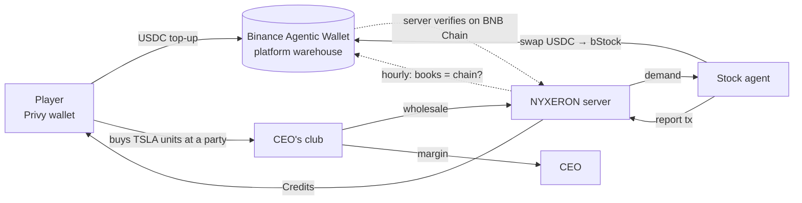

# NYXERON · Nightclub Empire

**The stock market, inside a nightclub, on BNB Chain.** A multiplayer nightclub game where every drink on the menu
is a tokenized stock: run a club, throw parties, and buy real tokenized shares, priced live from Binance, while a
stock agent keeps the warehouse filled on chain by itself.

|                          |                                                                                                                                     |
| ------------------------ | ----------------------------------------------------------------------------------------------------------------------------------- |
| ▶️ **Demo video (2:41)** | **[youtu.be/0ZWkMoz8P5Q](https://youtu.be/0ZWkMoz8P5Q)**                                                                            |
| 🎮 **Play**              | **[nyxeron.xyz](https://nyxeron.xyz)** (landing page → _Enter_ → sign in with email or Google)                                      |
| 📚 **Docs**              | **[docs.nyxeron.xyz](https://docs.nyxeron.xyz)** (the game, the engine as formulas, the on-chain economy)                           |
| 𝕏 **Updates**            | **[@nyxeron_xyz](https://x.com/nyxeron_xyz)**                                                                                       |
| 🛠️ Back office           | [admin.nyxeron.xyz](https://admin.nyxeron.xyz) (team only)                                                                          |
| 🔌 Public API            | [api.nyxeron.xyz/api/quotes](https://api.nyxeron.xyz/api/quotes) (live spot prices) · [/api/city](https://api.nyxeron.xyz/api/city) |

[](https://youtu.be/0ZWkMoz8P5Q)

---

## The problem

Tokenized stocks are live on BNB Chain: Tesla, Nvidia, the S&P 500, around the clock. But most people only ever
meet them as a trading screen, and most people will never open a trading app. The asset class is real; the way
in is not fun, not social, and not obvious.

## Our solution

Everybody knows how to throw a party. NYXERON puts the stock market into a nightclub:

- **Play (Classic mode, free).** Grow a token booth into a 500-guest venue over 60 nights. Every drink is a
  tokenized stock with a **live spot price from the Binance Web3 API (RWA data)**. Pick suppliers, set your
  markup, book DJs, run promos, hire security, keep your permits. At night the crowd buys, and prices move every
  minute with the crowd's energy. You learn how prices, baskets and markups work by running a club.
- **Real money (the City).** Sign in with email or Google and get a **BNB Chain wallet (Privy)**. Top up with
  **USDC**: $1 = 100 Credits, minus a 1% fee. CEOs rent venues by the week and throw parties; guests buy **real
  tokenized shares (bStock)**, 0.001 share per unit. The platform takes wholesale, the CEO keeps the margin, the
  guest keeps the shares.
- **The agent.** Every share sold comes from a warehouse of real bStock held in a **Binance Agentic Wallet**.
  When it runs low, our **stock agent restocks it on its own**: it reads demand, checks the token contract against
  Binance's RWA list, refuses bad prices, swaps USDC → bStock on BNB Chain, and the server verifies the swap on
  chain before a single unit is booked.

## What's new here

- **Tokenized stocks as gameplay, not a chart.** The drinks _are_ the assets; markups, baskets and live prices are
  the mechanics.
- **An agentic supply chain.** Real inventory is bought by an autonomous agent (Binance Agentic Wallet), on a
  schedule, within hard caps, with no human pressing _buy_.
- **Every unit is backed.** What players hold in the City is real bStock in the platform's wallet, and the books are
  reconciled against the chain every hour. If they disagree, payments stop.
- **Same club, two economies.** Classic is free play money for learning; the City is real money with the same rules,
  so players graduate from one to the other.

## Why it holds up

- **Live on BNB Chain mainnet**, with real transactions (below), not a testnet mock.
- **Nothing that pays out trusts the browser.** Top-ups, rent, sales, the warehouse and the agent's purchases are
  settled by the server, which reads BNB Chain itself.
- **A deterministic simulation core.** The whole club (guests, crowd energy, market, fights, inspections, tax) is a
  pure, seeded TypeScript engine with every rule unit-tested; a balance bot plays thousands of careers in CI.
- **Hardened for production.** Every pull request goes through adversarial ("brutal") tests: concurrency, replays,
  double spends, hostile inputs, RPC failures, before it is merged.
- **Live multiplayer.** CEOs host, guests walk in, DJs play live sets for the whole room through a small Go relay.

## On-chain proof (BNB Chain mainnet)

| What                                               | Link                                                                                                        |
| -------------------------------------------------- | ----------------------------------------------------------------------------------------------------------- |
| Agentic Wallet (warehouse)                         | [`0xcDFa…170f`](https://bscscan.com/address/0xcDFa725242E29921468a7482E8F3990fc40E170f)                     |
| Tesla bStock (TSLAB)                               | [`0x5b19…292f`](https://bscscan.com/token/0x5b1910eaad6450e50f816082aa078c41f10c292f)                       |
| Agent swap 1: 3 USDC → 0.00784374 TSLAB (+7 units) | [`0x4eb8…db91`](https://bsctrace.com/tx/0x4eb8b500e2f3ed5a638a49e73117b1ac98e0192214aa5dfc3d80dfb1e7efdb91) |
| Agent swap 2: 3 USDC → 0.00784407 TSLAB (+8 units) | [`0x955a…f1ec`](https://bsctrace.com/tx/0x955a498547fab0bf334f4c165426829f98d9cc297f31724265a49777eb82f1ec) |

Both swaps were placed by the stock agent on its own schedule; the warehouse then counted 15 units on the books and
15 on chain.

## How it works



1. **Top up.** The player sends USDC from their Privy wallet; the browser only reports the tx hash. The server reads
   the transfer on BNB Chain and credits the account once the transfer is final.
2. **Play the City.** Rent a venue (weekly, in Credits), price the menu between wholesale and 3× wholesale, open a
   party. Guests buy units of real bStock; the sale settles on the server.
3. **Restock.** The agent (`apps/agent`) runs every 10 minutes: demand → quote → contract and price checks → swap
   through the Binance Agentic Wallet → report. The server verifies the swap on chain and books exactly what arrived.
4. **Reconcile.** Every hour the back office checks the books against the wallet; a mismatch pauses payments until a
   person clears it.

Details: [docs/payments.md](docs/payments.md) · [apps/agent/README.md](apps/agent/README.md) ·
[docs/architecture.md](docs/architecture.md).

## Built with

|                            |                                                                                                                    |
| -------------------------- | ------------------------------------------------------------------------------------------------------------------ |
| **BNB Chain**              | Mainnet; tokenized stocks (bStock, e.g. TSLAB) and USDC                                                            |
| **Binance Web3 API**       | RWA data: live spot prices for every stock in the game                                                             |
| **Binance Agentic Wallet** | The stock agent's quotes and swaps (`@binance/agentic-wallet`)                                                     |
| **Privy**                  | Email/Google sign-in with an embedded BNB Chain wallet                                                             |
| **Stack**                  | TypeScript · React 19 · Vite · Tailwind v4 · three.js · Web Audio · Vitest · Go · SQLite · Docker · Caddy · Vercel |

## Team

[@riorblade](https://github.com/riorblade) · [@AdityaWisnuu](https://github.com/AdityaWisnuu) ·
[@ghozzza](https://github.com/ghozzza)

---

## For developers

### Monorepo

```
nyxeron/
├─ apps/
│  ├─ web/        Game client: React 19, Vite, Tailwind v4, three.js venue, Web Audio DJ studio
│  ├─ admin/      Back office: React, Privy sign-in, role-gated
│  └─ agent/      Stock agent: restocks the warehouse through the Binance Agentic Wallet
├─ packages/
│  └─ core/       Simulation engine + game data (pure TS, seeded RNG, no DOM)
├─ services/
│  ├─ api/        Go: accounts, wallets, top-ups, city (rent/shops/parties), warehouse, back office, quotes
│  └─ relay/      Go: multiplayer rooms and frame routing only (no game logic, no DB)
├─ deploy/        Docker Compose + Caddy for the VPS, the agent container
├─ docs/          PRD, architecture, game design, payments, API reference, roadmap, changelog; docs/site = public docs
└─ scripts/       Repo tooling (e.g. sync game data into the api)
```

Each app, package and service has its own README.

### Quick start

Requirements: Node 22 (`.nvmrc`), **pnpm 10 only** (`corepack enable`; npm/yarn/bun are refused), Go 1.26.

```sh
pnpm install
cp apps/web/.env.example apps/web/.env.local       # add VITE_PRIVY_APP_ID (optional: without it, signed-out dev)
pnpm dev                                            # game → http://localhost:5173
```

Full stack (accounts, multiplayer, back office):

```sh
cp deploy/.env.example deploy/.env                  # Privy app id + secret, ADMIN_EMAILS, Binance keys (optional)
set -a; . deploy/.env; set +a
DB_PATH=services/api/dev.db pnpm dev:api            # api   → :8788
pnpm dev:relay                                      # relay → :8787
pnpm dev:admin                                      # back office → http://localhost:5174
```

Vite proxies `/api` and `/ws` to the local services, so no CORS setup is needed in development.

### Scripts

| Command                      | What                                                             |
| ---------------------------- | ---------------------------------------------------------------- |
| `pnpm dev` / `dev:admin`     | Game / back office dev servers                                   |
| `pnpm dev:api` / `dev:relay` | Go services (`go run`)                                           |
| `pnpm agent`                 | The stock agent (quote only unless `--buy`; see its README)      |
| `pnpm test`                  | Vitest: core rules, persistence, balance guard rail, web units   |
| `pnpm test:brutal`           | Full hostile fuzz of the sim (smoke-sized in `pnpm test`)        |
| `pnpm test:go`               | Go tests with the race detector (relay + api)                    |
| `pnpm lint`                  | Typecheck (core, web, admin) + ESLint + Prettier check           |
| `pnpm build`                 | Production builds                                                |
| `pnpm balance [runs]`        | Bot careers: outcomes and the day each venue level is reached    |
| `pnpm balance:levels [runs]` | Per level: fights a night, tax share, profit                     |
| `pnpm sync:gamedata`         | Copy core data the api settles with into `services/api/gamedata` |

### Documentation

| Doc                                          | For                                                                 |
| -------------------------------------------- | ------------------------------------------------------------------- |
| [docs.nyxeron.xyz](https://docs.nyxeron.xyz) | Public docs: the game, the engine as formulas, the on-chain economy |
| [docs/PRD.md](docs/PRD.md)                   | Product: vision, users, features, economy, success                  |
| [docs/architecture.md](docs/architecture.md) | System design, data flow, trust model                               |
| [docs/game-design.md](docs/game-design.md)   | Rules (R1–R19), levels, night simulation, the city, balance         |
| [docs/payments.md](docs/payments.md)         | Top-ups, Credits, the warehouse, the agent, reconciliation          |
| [docs/api.md](docs/api.md)                   | HTTP API: player, city, back office, agent                          |
| [docs/multiplayer.md](docs/multiplayer.md)   | Relay protocol and live session sync                                |
| [docs/roadmap.md](docs/roadmap.md)           | What's next                                                         |
| [docs/changelog.md](docs/changelog.md)       | What shipped, when, and the numbers behind it                       |
| [deploy/README.md](deploy/README.md)         | Running it on a VPS and Vercel                                      |
| [CONTRIBUTING.md](CONTRIBUTING.md)           | Workflow, conventions, definition of done                           |
