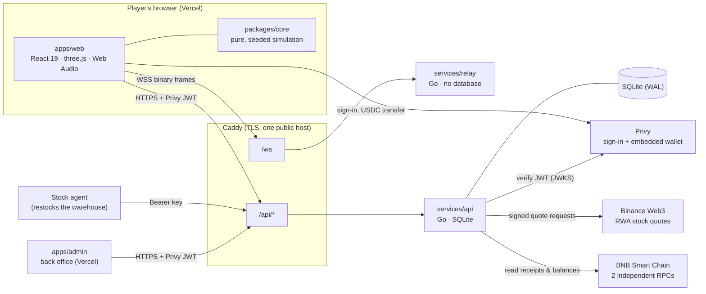
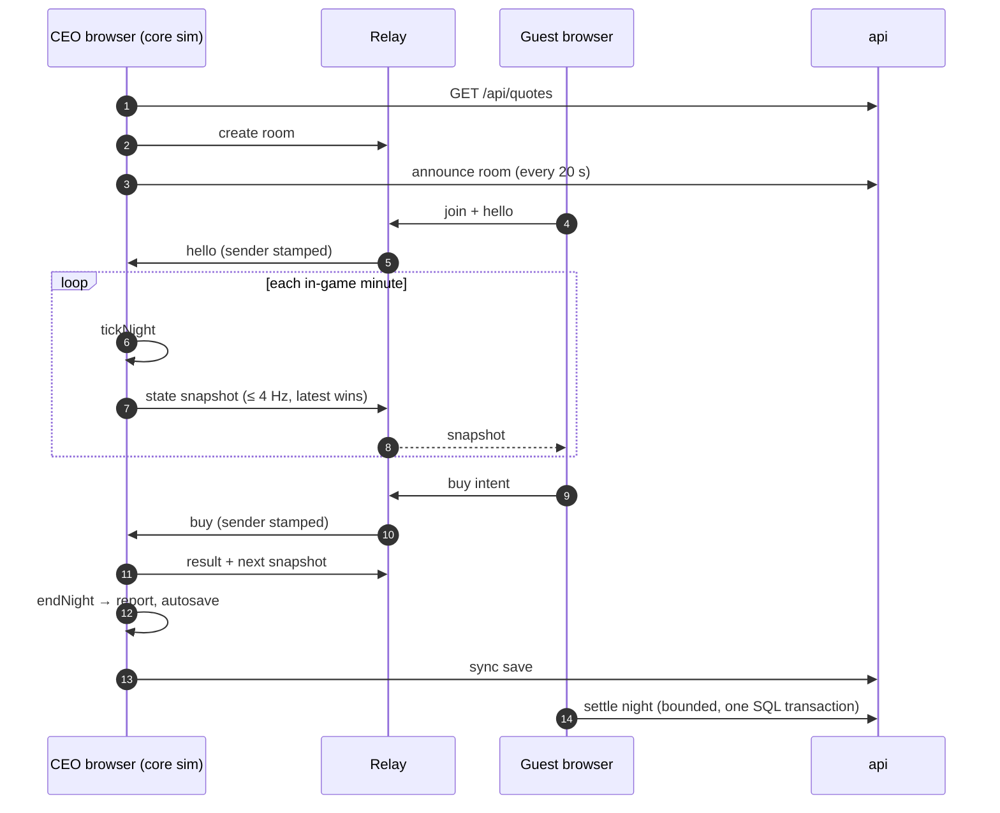

NYXERON is built so that the fun part runs in the browser and the money part runs on the server. The club simulation
is a pure TypeScript library that every browser runs locally; two small Go services connect players and settle
anything of value; BNB Chain is the source of truth for real deposits and real stock.

## System diagram

## What runs where

| Part | Runs on | Stack | Job |
| --- | --- | --- | --- |
| `packages/core` | Every browser (and Node for tests and bots) | Pure TypeScript, seeded PRNG | Every game rule: day actions, the 360-minute night, guests, prices, staff, levels |
| `apps/web` | Vercel, `nyxeron.xyz` | React 19, Vite, Tailwind v4, zustand, three.js, Web Audio, Privy | Screens, HUD, the 3D club, the DJ studio, and the live-session host/guest/DJ logic |
| `apps/admin` | Vercel, `admin.nyxeron.xyz` | React 19, Vite | Back office UI. It holds no logic; every check happens in the api |
| `services/relay` | Container behind Caddy, `/ws` | Go, `coder/websocket` | Rooms and frame routing for live multiplayer. Never reads game data |
| `services/api` | Container behind Caddy, `/api/*` | Go standard library, SQLite (pure Go driver, no CGO) | Accounts, play wallets, save sync, City venues, the stock warehouse, top-ups, sales, back office |
| Privy | Third party | JWT (ES256) + embedded EVM wallet | Email/Google sign-in; every player gets a BNB Chain wallet without installing anything |
| Binance Web3 | Third party | Signed HTTPS (HMAC-SHA256) | Live prices of tokenized stocks (TSLA, NVDA, index baskets…) |
| BNB Smart Chain | Public chain (chain id 56) | Read through two independent RPC endpoints | Ground truth for deposits and for the stock the platform actually holds |

Both Go services ship as static binaries in empty (`scratch`) images, run as an unprivileged user with a read-only
filesystem and dropped capabilities, and are capped at 48 MB of memory each.

## Trust model

The whole design follows one sentence: **the browser asks, the server settles.**

<CardGroup cols={2}>
<Card title="The simulation is pure" icon="flask">
All game logic lives in `packages/core`: no DOM, no network, no clock, no `Math.random()`. Randomness comes from a
seeded deterministic PRNG (mulberry32) stored in the game state, so a night replays bit-for-bit.
</Card>
<Card title="Value moves only on the server" icon="vault">
Anything that changes NYX Points, Credits, stock units or access is decided in `services/api`, inside a single SQL
transaction, with a ledger row written next to the balance change.
</Card>
<Card title="The chain is read, not reported" icon="link">
For a deposit the browser sends only a transaction hash. The api reads amount, sender and recipient from the chain
itself, requires two independent RPCs to agree, and waits for 15 confirmations.
</Card>
<Card title="Identity comes from the token" icon="id-card">
The api verifies the Privy JWT itself (ES256, issuer, audience, expiry). The player id is the token's subject, never
a field in the request body.
</Card>
<Card title="The relay is a dumb pipe" icon="route">
The relay routes binary frames by a 3-byte header and never parses the payload. It stamps the sender id on every
frame a guest sends, so a guest cannot pretend to be someone else.
</Card>
<Card title="Every admin action leaves a trace" icon="scroll">
Back-office changes need a reason and write an audit row in the same transaction. Admins cannot mint Credits or
stock without an on-chain transaction behind them.
</Card>
</CardGroup>

On top of that, an hourly reconciliation compares the books with the chain: Credits owed to players must be covered
by the stablecoins in the platform wallet, and stock units counted in the database must be covered by the tokenized
stock it holds on-chain. If either check fails, payments pause automatically until the books match again.

| Who | Decides | Cannot decide |
| --- | --- | --- |
| Browser (any player) | Its own UI, its own practice career, what it *wants* to do | Its balance, a deposit amount, a sale price outside the allowed band |
| CEO browser in a live room | The club's live state for that night: guests, prices, who is on the decks | Anything that is written to an account; the api bounds every result it receives |
| Relay | Which room a socket is in, who is host (by secret token), the sender id of guest frames | The content of any frame |
| api | Balances, ledgers, sales, City leases, access | On-chain facts; it only reads them |

## One night, end to end

<Steps>
<Step title="Day: prepare in the browser">
The CEO orders stock, books staff and a DJ, runs promotion. Each action is a pure core function that returns a new
state or a typed failure. Live stock prices come from `GET /api/quotes` (Binance RWA feed, cached for 60 seconds).
</Step>
<Step title="Open the club">
`startNight` begins a 360-minute night at 22:00. If the CEO goes live, the browser opens a relay room and announces it
to the api every 20 seconds, so it shows up in "Clubs open now".
</Step>
<Step title="Night: the host simulates, everyone watches">
`tickNight` advances one in-game minute every second (or two or three per second at 2× and 3×). After any change the
host sends a gzipped snapshot of the club, at most four times per second. Guests and the DJ send only intents
(`buy`, `mix`); the host applies them and the next snapshot shows the result to everyone.
</Step>
<Step title="Close at 04:00">
`endNight` produces the night report. The career autosaves locally and syncs to the api (newest save wins), so it
follows the player to any device.
</Step>
<Step title="Settle on the server">
A guest's night is settled by the api inside one transaction: the wallet can only shrink by what was spent, and the
tokens taken home cannot cost more than that. At City parties, purchases of real tokenized stock are paid in Credits:
the api holds the Credits, reserves the units from the warehouse, and settles 30 minutes after the party ends, paying
the club owner their margin over the wholesale price.
</Step>
</Steps>

Read next: [Live multiplayer](/multiplayer-live) for the wire protocol and DJ sync, and
[Tech stack & quality](/tech-stack) for how all this is tested.
