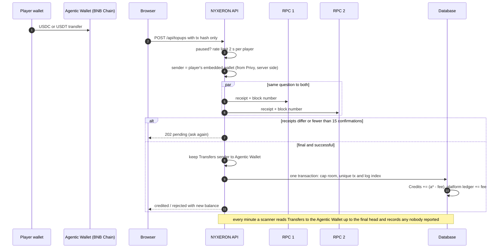
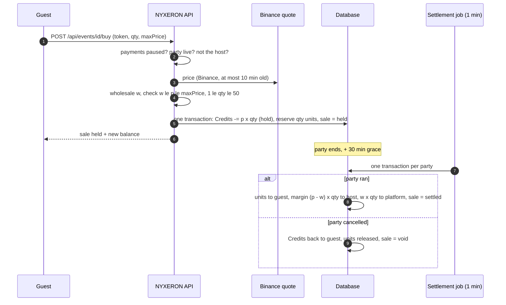

NYXERON runs two economies side by side. The classic game is play money and can never touch real value. The city
runs on **Credits**, which exist only because a stablecoin really arrived in the platform's wallet on BNB Chain, and
buys **real tokenized stock** (bStock) that the same wallet really holds. Every rule below exists to keep one promise:
nothing in the game is worth more than what is on-chain.

## The four currencies

| Currency | Where it comes from | What it buys | Backing |
| --- | --- | --- | --- |
| **NYX Points** (play money) | 20,000 starter wallet, refilled when below 2,000, DJ gigs, admin grants | Classic and practice nights | None. It cannot be converted into Credits |
| **Credits** | Only a verified USDC or USDT top-up on BNB Chain | Venue rent, real stock at city parties and shops | USDC + USDT in the Agentic Wallet, 100 Credits = 1 USD |
| **Play portfolio** | Stock "bought" during a night as a guest | Score and PnL | None |
| **Real units** | A settled purchase in the city | Held by the player | bStock in the Agentic Wallet, 1 unit = 0.001 share |

Source: `services/api/store.go:24-25`, `store.go:191-214`, `packages/core/src/data/payments.json`

Credits can only change through one function that moves the balance and writes a ledger row in the same database
transaction, and the balance can never go below zero. The play-money path never touches Credits.

Source: `services/api/store.go:197-214`

### Parameters

| Symbol | Value | Key |
| --- | --- | --- |
| $\kappa$ | 100 Credits per USD | `payments.json → creditsPerUsd` |
| $\sigma$ | 0.001 share per unit | `payments.json → sharesPerUnit` |
| $\varphi$ | 1 % top-up fee | `payments.json → topup.feePercent` |
| $m$ | 3 USD minimum top-up | `payments.json → topup.minUsd` |
| $K_{\text{day}}$ | 20 USD per rolling 24 h | `payments.json → topup.capUsdPerDay` |
| $K_{\text{tot}}$ | 100 USD lifetime | `payments.json → topup.capUsdTotal` |
| $N_{\text{conf}}$ | 15 confirmations | `payments.json → confirmations` |
| chain | 56 (BNB Smart Chain) | `payments.json → chainId` |
| $\mu$ | 3 × wholesale maximum price | `city.json → shop.maxMarkup` |
| $q_{\max}$ | 50 units per purchase | `city.json → shop.maxBuy` |
| $g$ | 30 minutes settlement grace | `city.json → party.settleGraceMinutes` |
| $L_{\text{swap}}$, $L_{\text{day}}$ | 50 USD per swap, 500 USD per 24 h | `payments.json → agent.maxUsdPerSwap`, `agent.maxUsdPerDay` |
| rent | 100 / 200 / 500 / 1,000 / 2,000 Credits per week (venue level 1 to 5) | `payments.json → rentCredits` |

Accepted stablecoins are USDC and USDT (BEP-20, 18 decimals). The only stock sold for Credits today is Tesla as the
bStock **TSLAB**, its contract locked in `payments.json → tokens.tsla.contract`.

## Top-up: stablecoin in, Credits out

A player sends USDC or USDT from their embedded wallet to the platform's Agentic Wallet. The browser only reports the
transaction hash; the amount, sender and recipient are read from the chain by the server. A background scanner also
picks up transfers nobody reported, so a closed tab never loses a top-up.

### Finality: two RPCs must agree

A transaction is final only when two independent BNB Chain RPC endpoints return the same receipt, the receipt says
success, and it is buried deep enough counted from the **lower** of the two chain heads:

$$
\text{final}(tx) \iff \rho_1(tx) = \rho_2(tx) \;\land\; \text{status}(tx) = 1 \;\land\; \min(h_1, h_2) - b_{tx} + 1 \ge N_{\text{conf}}
$$

where $\rho_i(tx)$ is the receipt as RPC $i$ returns it (compared field by field), $h_i$ is RPC $i$'s latest block
number, and $b_{tx}$ is the block that contains the transaction. Each RPC is also checked once to be on chain 56.
If the two disagree, nothing is credited and the report is answered "pending" or "chain unavailable" to be retried.

Source: `services/api/bsc.go:249-274`, `bsc.go:303-323`, `bsc.go:325-370`, `bsc.go:373-390`

### Credits minted

For each USDC/USDT transfer from the player's wallet to the Agentic Wallet in that transaction:

$$
a = \left\lfloor \frac{A}{10^{16}} \right\rfloor,
\qquad
R = \max\!\Big(0,\; \min\big(100K_{\text{day}} - D,\; 100K_{\text{tot}} - T\big)\Big),
\qquad
a^{*} = \min(a, R)
$$

$$
f = \left\lceil \frac{\varphi \, a^{*}}{100} \right\rceil,
\qquad
C =
\begin{cases}
0 & \text{if } a^{*} < 100\,m \quad \text{(rejected)}\\[4pt]
\left\lfloor \dfrac{(a^{*} - f)\,\kappa}{100} \right\rfloor & \text{otherwise}
\end{cases}
$$

where

- $A$ is the transferred amount in the token's base units (18 decimals, 1 token = 1 USD);
- $a$ is that amount in whole US cents, rounded **down**;
- $D$ and $T$ are the cents this player has had credited in the last 24 hours and in total;
- $R$ is the room left under both caps, in cents, and $a^{*}$ is the part that may be credited;
- $f$ is the fee in cents, rounded **up** (it pays for sponsored gas) and booked as platform money;
- $C$ is the Credits minted. With $\kappa = 100$ this is simply $C = a^{*} - f$: one Credit per cent.

Whatever is not credited, $a - a^{*}$ cents (or all of $a$ when rejected), is recorded with the reason so the team can
refund it by hand. The cap room is computed inside the same database transaction that writes the Credits, and the
API's single database connection serializes those transactions, so two simultaneous top-ups cannot share the same room.
A transfer is credited at most once: the pair (transaction hash, log index) is unique.

Source: `services/api/topups.go:44-51`, `topups.go:66-69`, `topups.go:83-151`, `topups.go:154-162`, `topups.go:165`

<Accordion title="Worked example">
A new player sends **10 USDC**: $A = 10 \times 10^{18}$, so $a = 1000$ cents. Nothing credited yet, so
$R = \min(2000, 10000) = 2000$ and $a^{*} = 1000 \ge 300$. Fee $f = \lceil 1000 / 100 \rceil = 10$ cents.
The player gets **990 Credits**; the platform books 10.

Later the same day they send another **10 USDC** after 15 USD already credited in the last 24 hours:
$R = \min(2000 - 1500,\; 10000 - 1500) = 500$, so $a^{*} = 500$, $f = 5$, and the player gets **495 Credits**.
The other 500 cents are recorded as over the cap, to be refunded.

Had the room been only 200 cents, $a^{*} = 200 < 300$ and the whole transfer would be recorded as rejected, with no
Credits minted.
</Accordion>

### Top-up sequence

Source: `services/api/topups.go:254-343`, `topups.go:355-426`, `services/api/main.go:128`

## Selling real stock

The venue tenant (the "CEO") is a reseller: they hold no stock and need no capital. They set a price; a guest buys
from the platform's warehouse at that price; the platform keeps the wholesale and the CEO keeps the margin.

### Wholesale price

The platform's cost of one unit (0.001 share), in Credits, from a live Binance quote:

$$
N = \operatorname{round}\!\left(\frac{1}{\sigma}\right) = 1000,
\qquad
w = \max\!\left(1,\; \left\lceil \frac{\operatorname{round}(\pi\,\kappa)}{N} \right\rceil\right)
$$

where $\pi$ is the stock's price in USD per share, $\operatorname{round}(\pi\kappa)$ is that price in whole Credits per
share, and $w$ is Credits per unit, rounded **up** so the platform is never under-paid. There is no price, and nothing
can be sold, when the quote is not from Binance, is older than 10 minutes, or implies more than 1,000,000 Credits per
unit (a broken feed).

Source: `services/api/sales.go:40-60`, `sales.go:64-76`

### The CEO's price

$$
w \;\le\; p \;\le\; \mu\, w
$$

where $p$ is the CEO's price in Credits per unit. This band is checked when the price list is set (and a party's prices
lock once it starts). At the moment of purchase the server checks again:

$$
1 \le q \le q_{\max},
\qquad
p \le p_{\text{seen}},
\qquad
p \ge w_{\text{now}}
$$

where $q$ is the quantity, $p_{\text{seen}}$ is the price the buyer saw and agreed to (required, at least 1), and
$w_{\text{now}}$ is wholesale re-computed from the current quote. If the market rose above the CEO's price the sale is
refused rather than sold at a loss; if the price changed under the buyer, it is refused too.

Source: `services/api/sales.go:80-97`, `sales.go:214-232`, `sales.go:565`, `sales.go:603`

### The split

Every settled sale of $q$ units at price $p$ with recorded wholesale $w$ moves:

$$
\underbrace{p\,q}_{\text{buyer pays}} \;=\; \underbrace{(p - w)\,q}_{\text{CEO margin}} \;+\; \underbrace{w\,q}_{\text{platform}},
\qquad
\Delta\,\text{units}_{\text{buyer}} = +q,
\qquad
\Delta\,\text{warehouse} = -q
$$

Source: `services/api/sales.go:323-357`

### Shop vs party: hold, then settle

- **Shop**: the purchase debits the buyer, reserves the units and settles at once, in one database transaction.
- **Party**: the purchase debits the buyer into a **hold** and reserves the units. A job running every minute settles
  every held sale of a party once it is over, at $t \ge t_{\text{end}} + g$. If the party is cancelled, held sales are
  voided instead: Credits back to the guest, units back on the shelf. An admin can also void a single held sale.

Settling and voiding both only act on a sale still in the "held" state, so each sale settles or voids exactly once.
Reservations never exceed what is on hand, so the warehouse cannot be oversold.

Source: `services/api/sales.go:236-319`, `sales.go:363-412`, `sales.go:440-463`, `services/api/restock.go:226-253`, `main.go:133`

<Accordion title="Worked example">
Take TSLA at $\pi = 370.00$ USD. Then $\operatorname{round}(370 \times 100) = 37000$ Credits per share and
$w = \lceil 37000 / 1000 \rceil = 37$ Credits per unit. The CEO may price between 37 and $3 \times 37 = 111$.

They set $p = 50$. A guest buys $q = 10$ units at a party: 500 Credits go on hold and 10 units are reserved. Thirty
minutes after the party ends: the guest owns 10 real units, the CEO receives $(50 - 37) \times 10 = 130$ Credits,
and the platform books $37 \times 10 = 370$.
</Accordion>

### Sale sequence (party)

## Reconciliation: the books must be backed on-chain

Every hour (and on demand from the back office) the API reads the Agentic Wallet's balances through both RPCs and
checks the database against them. It is an inequality, not an equality: the chain may hold more than the books (a
fraction of a share left over by rounding, an unrecorded deposit), never less.

**Credits are backed by stablecoins:**

$$
\sum_{u} c_u \;+\; \sum_{s \in H} p_s\, q_s \;\;\le\;\; \underbrace{\left\lfloor \frac{B_{\text{USDC}}}{10^{16}} \right\rfloor + \left\lfloor \frac{B_{\text{USDT}}}{10^{16}} \right\rfloor}_{\text{wallet, cents}} \;-\; \max(P, 0)
\qquad\text{and}\qquad P \ge 0
$$

**Real stock is backed by bStock, per token $k$:**

$$
S_k + V_k + \sum_{u} U_{u,k} \;\;\le\;\; \left\lfloor \frac{B_k}{\sigma \cdot 10^{18}} \right\rfloor
$$

where

- $c_u$ is player $u$'s Credit balance and $H$ the set of held (unsettled) sales, so held Credits still count as owed;
- $B_{\text{USDC}}, B_{\text{USDT}}, B_k$ are the Agentic Wallet's on-chain balances in base units (18 decimals);
- $P = \sum$ platform ledger: fees, rent, wholesale and recorded seed money in, restock purchases out (in cents, since
  one Credit is one cent). $P < 0$ is itself a failure: it would mean a restock was paid with players' money;
- $S_k$ and $V_k$ are warehouse units on hand and reserved, and $U_{u,k}$ are player $u$'s real units.

Source: `services/api/reconcile.go:49-107`, `reconcile.go:136`, `services/api/restock.go:98-108`, `main.go:130`

**On mismatch, payments pause.** The list of problems is stored and every check is written to the audit log.
While paused, new top-ups are not credited and party and shop purchases are refused. Recording a restock is still
allowed, because it mints no Credits and is what brings the books back in line, but the stock agent itself refuses to
buy while the pause stands. The next check that passes lifts the pause automatically. A check that cannot read the
chain changes nothing either way.

Source: `services/api/reconcile.go:108-133`, `reconcile.go:157-166`, `services/api/topups.go:91`, `sales.go:238`, `sales.go:279`, `restock.go:129-131`, `apps/agent/src/main.ts:60-63`

## Restocking the warehouse

Warehouse units exist only for bStock the Agentic Wallet really bought. A stock agent swaps USDC for bStock on BNB
Chain and reports the transaction; the API reads the swap itself before adding a single unit.

### What the warehouse is short of

The API computes, per token, from units sold to players in the last 7 days:

$$
r = \frac{s_{7}}{7},
\qquad
\text{daysLeft} = \frac{S}{r},
\qquad
\text{suggested} = \max\!\Big(0,\; \big\lfloor 3r + 0.999 \big\rfloor - S\Big)
\qquad (r > 0)
$$

where $s_7$ is units sold in the last 7 days, $r$ the average units sold per day, $S$ the units on hand, and 3 the
number of days of demand to keep in stock. With no sales in 7 days, daysLeft is reported as $-1$ and nothing is
suggested.

Source: `services/api/supply.go:59-61`, `supply.go:86-90`

### What the agent does with it

The agent takes the whitelisted tokens with $\text{suggested} > 0$ and picks the one that runs out soonest (smallest
daysLeft, then the larger shortfall). It checks the locked bStock contract is the one Binance lists for that ticker.
The size of the swap is **not** derived from the suggestion: it spends a fixed USD budget per run
(`AGENT_BUY_USD`, default 3 USD, never above $L_{\text{swap}}$), with 1 % slippage, and refuses if payments are paused
or the swap would push its 24-hour spend over $L_{\text{day}}$.

Source: `apps/agent/src/plan.ts:16-20`, `plan.ts:23-28`, `apps/agent/src/main.ts:17`, `main.ts:29-30`, `main.ts:60-69`, `apps/agent/src/baw.ts:55`

### What the API counts

$$
\Delta S = \left\lfloor \frac{\Delta^{+}_{k}}{\sigma \cdot 10^{18}} \right\rfloor,
\qquad
\text{cost} = \sum_{\text{USDC, USDT}} \left\lceil \frac{\Delta^{-}}{10^{16}} \right\rceil
$$

accepted only if

$$
\Delta S > 0,\quad \text{cost} > 0,\quad \text{cost} \le 100\,L_{\text{swap}},\quad
\text{spent}_{24h} + \text{cost} \le 100\,L_{\text{day}},\quad
S_k + V_k + \sum_u U_{u,k} + \Delta S \le \left\lfloor \frac{B_k}{\sigma \cdot 10^{18}} \right\rfloor
$$

where $\Delta^{+}_k$ is the wallet's **net** bStock gain in the transaction, $\Delta^{-}$ the net stablecoin it paid
(transfers to itself ignored), cost is in cents rounded up, and the two spending limits bind the agent only (a
team-reported seed restock is not capped). A transaction counts once. The cost is booked as platform money out, so
restocks are paid from fees, rent and wholesale, never from players' Credits.

Source: `services/api/restock.go:33-49`, `restock.go:51-59`, `restock.go:118-204`

<Accordion title="Worked example">
Say the last 7 days sold 20 units and 5 are on hand: $r = 20/7 \approx 2.857$ per day, daysLeft $\approx 1.75$,
suggested $= \lfloor 8.571 + 0.999 \rfloor - 5 = 4$.

The agent swaps 3 USDC. Using the reference quote stored in `payments.json → tokens.tsla.quote`, 3 USDC bought
0.008089823483577623 TSLAB, so the API adds $\lfloor 0.00808982 / 0.001 \rfloor = 8$ units and books 300 cents of
platform money out. The leftover 0.00008982 share stays in the wallet as on-chain surplus.
</Accordion>

<Note>
There is no withdrawal yet: Credits and real units stay in the game, and each player's lifetime top-up is capped at
100 USD.
</Note>
