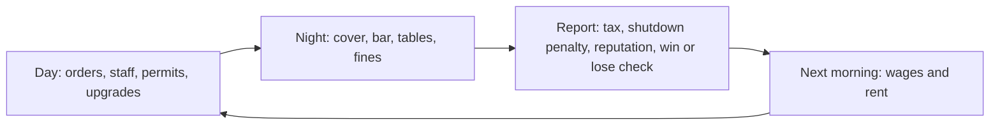

A career is a loop of **day** (plan, buy, hire), **night** (360 in-game minutes, 22:00 to 04:00) and **report**. Money moves at three points: during the night as sales happen, at the night report when tax and penalties settle, and the next morning when the bills are paid.

A new career starts at the Token Booth with 10,000 coins (`economy.json → startCoin`), multiplied by the difficulty's `coinMultiplier` (easy 1.5, normal 1, hard 0.6). It also starts with reputation 20, hype 0, safety 100 and a business permit.

Source: `packages/core/src/state.ts:330`

## Nightly P&L

**Why:** a night has three revenue lines with very different levers (price list, door policy, bookings). Splitting them lets the report show which one carried the night.

### Revenue

$$
R_d = R^{\text{bar}}_d + R^{\text{cover}}_d + R^{\text{table}}_d
$$

| Line | What adds to it | Source |
|---|---|---|
| $R^{\text{bar}}$ | every token sale at the price the guest paid (see [Market & pricing](/engine/market)) | `rules/inventory.ts:90` |
| $R^{\text{cover}}$ | each admitted guest pays $\min(\text{cover}_g, \text{budget}_g)$ at the door | `engine.ts:309` |
| $R^{\text{table}}$ | at minute 90 every booked seat pays its minimum spend; sparkler-parade bottles also land here | `engine.ts:377`, `rules/strategy.ts:463` |

### The night's coin change

Every coin movement during the night is applied as it happens. The report's **profit** is the coin balance at 04:00, after tax and any shutdown penalty, minus the balance at opening:

$$
\Pi_d \;=\; R_d \;-\; \Phi_d \;-\; K_d \;-\; F_d \;-\; X_d \;-\; T_d \;-\; Z_d
$$

Source: `packages/core/src/engine.ts:625`, `packages/core/src/engine.ts:667`

| Symbol | Meaning |
|---|---|
| $\Phi_d$ | platform fees: 5% of each sale's spread over spot cost (see [Market & pricing](/engine/market)) |
| $K_d$ | promoter commission, paid per guest-list guest admitted (60, 100 or 250 coins, `promoters.json → commission`) |
| $F_d$ | fines from a failed inspection (below) |
| $X_d$ | other spending made during the night: sparkler parades, night promos, emergency stock orders, auto-refill |
| $T_d$ | entertainment tax (R15) |
| $Z_d$ | crowd-shutdown penalty, if the venue was shut down (below) |

Wages and rent are **not** in $\Pi_d$. They are charged the next morning.

### Next morning: wages and rent (R12)

$$
\text{coin}_{d+1} = \text{coin}_d \;-\; \underbrace{\sum_{r} n_r\, w_r}_{\text{wages}} \;-\; \underbrace{\rho_L}_{\text{rent}}
$$

Source: `packages/core/src/rules/economy.ts:5`, `packages/core/src/rules/economy.ts:16`

where $n_r$ is the headcount in role $r$, $w_r$ its daily wage, and $\rho_L$ the venue's daily rent. Staff are paid for whoever is on the books, so nobody can be hired for just one night.

| Role | `wagePerDay` $w_r$ | Unlocks at level |
|---|---|---|
| Desk Broker (bartender) | 300 | 2 |
| Security | 400 | 3 |
| Host | 600 | 3 |
| Guest Relations | 700 | 3 |
| MC | 1,500 | 4 |

Source: `packages/core/src/data/staff.json`

Wages are flat coin amounts and do not scale with the venue's `priceScale`. The same morning, any orders due that day arrive, hype falls by 10 (`hypeDecayPerDay`), safety recovers by 10 up to 100 (`safetyRecoveryPerDay`), the CEO's energy resets to 5, and tonight's bookings, promos and promoters clear.

## Entertainment tax (R15)

**Why:** a booth that sells over the counter is a shop. Once there is live entertainment, the venue pays the tax that comes with it, and the rate climbs with the venue.

$$
T_d = \operatorname{round}\!\big(t_L \cdot (R^{\text{bar}}_d + R^{\text{cover}}_d + R^{\text{table}}_d)\big)
$$

Source: `packages/core/src/rules/economy.ts:44`

The tax is charged on **gross** revenue: bar revenue is counted before the platform fee is taken out. It is deducted at the night report.

| Level | Venue | `entertainmentTaxRate` $t_L$ |
|---|---|---|
| 1 | Token Booth | 0% |
| 2 | Token Shop | 0% |
| 3 | Token Bar & Live Music | 20% |
| 4 | Nightclub | 30% |
| 5 | Premium Venue | 40% |

Source: `packages/core/src/data/levels.json`

The rate is a flat percentage per venue level. It does not step up with the size of the night's revenue.

## Fines and penalties

**Why:** running a club means running it legally. Inspections, crowd limits and the door rules turn shortcuts into a gamble.

### Inspections

When the club opens, the night rolls once for an inspector with probability

$$
P(\text{inspection}) =
\begin{cases}
1 & \text{if forced (scripted, or a controversial promo backfired)}\\[2pt]
\max(b,\ 0.2) & \text{if safety} < 40\\[2pt]
b & \text{otherwise}
\end{cases}
\qquad
b = \begin{cases} 0.4 & \text{a required permit is missing or expired} \\ 0.05 & \text{otherwise}\end{cases}
$$

Source: `packages/core/src/rules/legal.ts:34`, `packages/core/src/engine.ts:209`

If it fires, the inspector arrives at a minute drawn uniformly from 0 to 359 (seeded PRNG). The inspection **fails** if any required permit is missing, or if an underage guest has been let in so far tonight. A failure costs:

- a fine of **5,000 coins** (`legal.json → inspectionFine`), a flat amount at every level,
- **+1 violation** on the career record,
- one sealed night (the venue cannot open) if the on-premise trading-floor licence is missing while only the takeaway licence is held (`sealedNightsOnTakeawayOnly`).

Source: `packages/core/src/rules/legal.ts:50`, `packages/core/src/engine.ts:596`

Required permits per level: Level 1 needs a business permit, Level 2 adds the OTC trading licence, and Levels 3 to 5 need the business permit plus the trading-floor licence.

| Permit | `cost` | `durationDays` | `minLevel` |
|---|---|---|---|
| Business permit | 1,000 | 30 | 1 |
| OTC trading licence | 5,000 | 30 | 2 |
| Trading-floor licence | 15,000 | 30 | 3 |
| Crowd permit | 10,000 | 7 | 4 |

Renewing a permit that is still active extends it from its current expiry date.

### Crowd shutdown (R7)

The first time more than 150 guests are inside (`crowdPermitThreshold`) without an active crowd permit, the night rolls once: with probability 0.5 the venue is shut down on the spot. Everyone leaves, and at the report the club also pays

$$
Z_d = \operatorname{round}\!\big(0.5\cdot R_d\big), \qquad \Delta\text{rep} = -10
$$

Source: `packages/core/src/engine.ts:328`, `packages/core/src/engine.ts:633`

### Forcing the door

Letting guests in past capacity is allowed once per night. It adds +1 violation at once, with no fine.

Source: `packages/core/src/rules/security.ts:46`

## Reputation update (R11)

**Why:** reputation is the long-term score. Happy guests talk, and a bad night costs more than a good night earns.

At the report, let $\bar\theta_d$ be the average satisfaction (0 to 100, rounded) of every guest admitted tonight. If nobody was admitted, reputation does not move.

$$
\Delta\text{rep}_d =
\begin{cases}
\operatorname{round}\!\left(3 + 5\cdot\dfrac{\bar\theta_d - 70}{30}\right) & \bar\theta_d \ge 70\\[10pt]
0 & 40 \le \bar\theta_d < 70\\[4pt]
-5 & \bar\theta_d < 40
\end{cases}
\qquad
\text{rep}_{d+1} = \operatorname{clamp}(\text{rep}_d + \Delta\text{rep}_d,\ 0,\ 100)
$$

Source: `packages/core/src/rules/reputation.ts:4`, `packages/core/src/engine.ts:643`

A good night therefore earns between +3 (at 70) and +8 (at 100). Reputation also moves during the night: each fight costs 5, and a crowd shutdown costs 10. A controversial promo that backfires (25% chance) costs 20.

| Parameter | Value | Key |
|---|---|---|
| Good night from | 70 | `night.json → goodNightSatisfaction` |
| Bad night below | 40 | `night.json → badNightSatisfaction` |
| Gain range | [3, 8] | `night.json → repGainRange` |
| Bad-night loss | 5 | `night.json → repLossBadNight` |
| Fight penalty | 5 rep, 15 safety | `night.json → fightRepPenalty`, `fightSafetyPenalty` |
| Shutdown penalty | 50% of revenue, 10 rep | `legal.json → shutdownRevenuePenalty`, `shutdownRepPenalty` |

## Venue levels and moving up (R18)

**Why:** each venue is a new game. It brings a bigger room, deeper pockets and higher prices, but also rent, tax and legal duties to match.

| Level | Venue | `cost` | `repRequired` | `capacity` | `demand` | `rentPerDay` | `coverCharge` | Tax | `priceScale` | `storage` |
|---|---|---|---|---|---|---|---|---|---|---|
| 1 | Token Booth | 0 | 0 | 20 | 260 | 100 | 0 | 0% | 1.5 | 1,000 |
| 2 | Token Shop | 50,000 | 20 | 40 | 260 | 500 | 0 | 0% | 4 | 1,500 |
| 3 | Token Bar & Live Music | 250,000 | 40 | 90 | 300 | 2,000 | 0 | 20% | 12 | 2,500 |
| 4 | Nightclub | 1,000,000 | 60 | 190 | 160 | 8,000 | 600 | 30% | 48 | 3,000 |
| 5 | Premium Venue | 5,000,000 | 75 | 500 | 600 | 30,000 | 2,500 | 40% | 60 | 5,000 |

Source: `packages/core/src/data/levels.json`

Moving from level $L$ to $L+1$ is a daytime action. It needs $\text{rep} \ge \textit{repRequired}_{L+1}$ and $\text{coin} \ge \textit{cost}_{L+1}$, and the cost is paid in full. On the move, with the rescale ratio

$$
\gamma = \frac{s_L}{s_{L+1}}
$$

every quantity is converted **at value, not at count**, so stock bought cheaply at the old venue cannot be resold at the new venue's prices:

$$
\text{stock}'_k = \lfloor \gamma \cdot \text{stock}_k \rfloor,
\qquad
q'_o = \lfloor \gamma \cdot q_o \rfloor \ \ \text{(pending orders)},
\qquad
\ell'_k = \operatorname{round}\!\left(\frac{\ell_k}{\gamma}\right)
$$

Source: `packages/core/src/rules/progression.ts:16`

| Symbol | Meaning |
|---|---|
| $s_L$ | `levels.json → priceScale` of the current venue |
| $\text{stock}_k$, $q_o$ | lots on the shelf, lots in pending order $o$ |
| $\ell_k$ | the player's list price; the markup over standard carries over |

All upgrades (sound, lighting, VIP lounge, capacity, storage) reset to zero, because the new venue comes with its own house rig. Coin is not rescaled, and reputation, staff and permits carry over. Every coin price that is defined in base units (supplier costs, standard prices, upgrade and sparkler costs, guest budgets, the cover reference, seat minimum spends) is multiplied by the new $s_{L+1}$ from then on.

## Winning and losing

**Why:** a career needs a finish line and a way to fail. Bankruptcy, the law and the crowd's opinion are the three ways a club dies.

Checked at the end of every night, after tax and reputation, in this order:

**Defeat (R13).** Let $N_d$ count consecutive nights that ended with negative coin:

$$
N_d = \begin{cases} N_{d-1} + 1 & \text{coin}_d < 0 \\ 0 & \text{otherwise}\end{cases}
\qquad
\text{defeat} \iff N_d \ge 3 \ \lor\ V \ge 3 \ \lor\ \text{rep} \le 0
$$

Source: `packages/core/src/rules/economy.ts:62`

where $V$ is the career's violation count. Violations never expire. The negative-cash check happens at the report, so the morning's wages and rent can push the balance below zero and only count against the club at the next night's report. Defeat is final.

**Victory or survival (R14).**

$$
\text{outcome} =
\begin{cases}
\text{victory} & L = 5 \ \land\ \text{rep} \ge 80\\[2pt]
\text{survived} & d \ge 60 \text{ (and not already in free play)}\\[2pt]
\text{play continues} & \text{otherwise}
\end{cases}
$$

Source: `packages/core/src/rules/progression.ts:7`

After a victory or survival the player may play on as an open-ended career. A club that only survived can still win later. Hosted event nights never end a career either way.

**The Basement scenario** (a one-week challenge at a Level 4 club) ends after day 7: victory if reputation is at least 60 with zero violations, otherwise survived (`scenarios.json → basement.goalReputation`, `lastDay`).

Source: `packages/core/src/scenario.ts:73`

| Parameter | Value | Key |
|---|---|---|
| Bankrupt after | 3 nights in the red | `economy.json → bankruptAfterNegativeDays` |
| Max violations | 3 | `legal.json → maxViolations` |
| Victory reputation | 80 | `economy.json → victoryReputation` |
| Career length | 60 days | `economy.json → maxDays` |

## House rules

**Why:** the door is a strategy. Who gets in, at what price and in what shoes changes both how many people come and how much each one spends.

House rules unlock at **Level 3** and can only be changed by day. They stay in force until changed. Below Level 3 every rule below is ignored. Each one enters the expected guest count through a single multiplier:

$$
\Omega^{\text{policy}} = \underbrace{(1 + 0.12\cdot\mathbf{1}_{\text{ladies}})}_{\text{ladies' night}} \cdot \underbrace{\delta_{\text{dress}}}_{\text{dress code}} \cdot \underbrace{\chi_{\text{cover}}}_{\text{cover}}
$$

Source: `packages/core/src/rules/strategy.ts:64`, `packages/core/src/engine.ts:87`

$\Omega^{\text{policy}}$ multiplies the night's guest count alongside hype, reputation, safety and the weekday (see [Night loop](/engine/night-loop)).

### Cover charge

The standard cover $c^{\circ}_L$ is the venue's `coverCharge` (0 at Levels 1 to 3, 600 at Level 4, 2,500 at Level 5). The player can set any integer cover $c \ge 0$. Its distance from the standard, measured against a reference of $12\,s_L$, shifts both demand and the spending power of the crowd that comes:

$$
\chi_{\text{cover}} = \operatorname{clamp}\!\left(1 - 0.2\,\frac{c - c^{\circ}_L}{12\,s_L},\ 0.3,\ 1.5\right)
\qquad
\beta_{\text{cover}} = \operatorname{clamp}\!\left(1 + 0.15\,\frac{c - c^{\circ}_L}{12\,s_L},\ 0.8,\ 1.3\right)
$$

Source: `packages/core/src/rules/strategy.ts:77`, `packages/core/src/rules/strategy.ts:88`

$\beta_{\text{cover}}$ multiplies every arriving guest's budget. A cheap door fills the room with thriftier guests, and a pricey door draws fewer guests who spend more. Guest-list guests, and women on ladies' night, pay no cover.

### Dress code

| `dressCode` | Rejected at door (men) | Rejected at door (women) | Budget × | Extra weight on premium segment | Demand $\delta_{\text{dress}}$ |
|---|---|---|---|---|---|
| none | 0 | 0 | 1.0 | 0 | 1.00 |
| smart | 10% | 3% | 1.2 | +1 | 0.95 |
| strict | 25% | 8% | 1.4 | +2 | 0.85 |

Source: `packages/core/src/data/strategy.json → dressCode`, `packages/core/src/engine.ts:302`

Each guest who reaches the door is turned away with the probability in their column. A turned-away guest pays nothing and never comes in.

### Ladies' night

The share of women among arrivals rises from 0.42 to $0.42 + 0.14 = 0.56$, the crowd grows by 12%, and women enter free. Men spend more in a mixed room. Each male guest's budget is multiplied by

$$
\beta^{\text{male}} = 1 + 0.5\,(\text{femaleShare} - 0.42) + \min(0.3,\ 0.05\cdot n_{\text{host}})
$$

Source: `packages/core/src/rules/strategy.ts:57`, `packages/core/src/rules/strategy.ts:110`

That is +7% on ladies' night, plus up to +30% from hosts on shift (hosts apply whether or not it is ladies' night).

### Happy hour

Two ways to run it, both halving every list price while they are on (price factor 0.5, see [Market & pricing](/engine/market)):

| Mode | When | Extra effect | Source |
|---|---|---|---|
| Scheduled **early** (house rule) | minutes 0 to 59 | each guest due to arrive at minute 60 or later has a 25% chance to come in during the first hour instead (leave time unchanged) | `engine.ts:188` |
| Scheduled **late** (house rule) | minutes 300 to 359 | guests due to leave between minutes 240 and 359 stay 30 minutes longer, capped at closing | `engine.ts:195` |
| **CEO call** (once per night, any level) | from the call until 04:00 | +10 satisfaction to every guest inside at that moment | `rules/ceo.ts:9` |

Cheaper drinks raise the price ratio $\bar p_k / \ell^{\text{eff}}_k$ (capped at 1.5), so more guests order. Each sale earns half as much.

### Seat minimum spend

From Level 3 the player can also set a minimum spend per seat type (default `strategy.json → seats.*.defaultSpend` × $s_L$: VIP 750, sofa 300, table 200, bar 60). Bookings for VIP seats, sofas and tables come from Guest Relations staff. Bar seats fill with walk-ins. Pricing above the standard books fewer seats:

$$
B_\sigma = \min\!\Big(\text{seats}_\sigma,\ \operatorname{round}\big(D_\sigma \cdot \operatorname{clamp}(1 - e_\sigma(\tfrac{\text{spend}_\sigma}{\text{std}_\sigma} - 1),\ 0,\ 1.5)\big)\Big),
\quad
D_\sigma = \begin{cases} 1.5\, n_{\text{rel}}\,(0.5 + \tfrac{\text{rep}}{100}) & \text{VIP, sofa, table}\\ \text{seats}_{\text{bar}}\,(0.3 + \tfrac{\text{rep}}{200}) & \text{bar}\end{cases}
$$

Source: `packages/core/src/rules/strategy.ts:250`

with elasticity $e_\sigma = 0.5$ (0.7 for bar seats). Booked seats pay their minimum spend into table revenue at minute 90.

<Accordion title="Worked example: a Saturday at the Nightclub (Level 4)">
**During the night**

| Item | Amount |
|---|---|
| Bar sales | 60,000 |
| Cover: 80 paying guests × 600 | 48,000 |
| Tables: 2 sofas × (300 × 48 = 14,400) | 28,800 |
| **Gross revenue $R$** | **136,800** |
| Platform fees (assumed for this example) | −2,400 |
| Elite List promoter: 12 guests × 250 | −3,000 |
| **Entertainment tax** $\operatorname{round}(0.30 \times 136{,}800)$ | **−41,040** |
| **Night profit $\Pi$** | **90,360** |

**Reputation.** Average satisfaction 85: $\operatorname{round}(3 + 5 \times 15/30) = \operatorname{round}(5.5) = 6$, so +6.

**Next morning.** Staff: 3 brokers (900), 4 security (1,600), 2 Guest Relations (1,400), 1 MC (1,500) = 5,400 in wages, plus 8,000 rent. The day starts 13,400 lighter.

**Had the inspector come** with a lapsed trading-floor licence: −5,000 and one violation, the second strike of three.

**Moving up to Premium Venue** later needs 5,000,000 coins and reputation 75. With $\gamma = 48/60 = 0.8$, 500 lots of NVIDIA become $\lfloor 0.8 \times 500 \rfloor = 400$ lots, and a list price of 1,920 becomes $\operatorname{round}(1{,}920 / 0.8) = 2{,}400$.
</Accordion>
