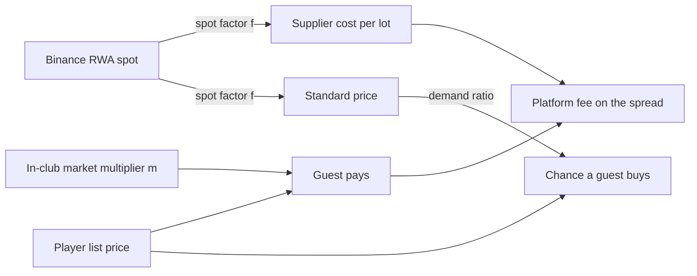

In NYXERON the drinks are tokenized stocks. Every price a player sees comes from four layers on top of each other:

1. **Real spot.** Binance's RWA feed of tokenized stocks on BNB Chain sets how much a lot costs to buy.
2. **Venue scale.** Each venue level has its own coin scale. A Premium Venue charges and pays 40 times what the Token Booth does.
3. **The player's price list.** The CEO picks a list price per token, and that choice changes demand.
4. **The in-club market.** During the night each token trades on a live multiplier that moves with the crowd's energy and the DJ.

<Note>
All randomness in the market comes from a seeded deterministic pseudo-random generator whose state is stored in the save, so the same night replays bit-for-bit.
</Note>

## Tokens on the menu

A token is either a single stock (one ticker at weight 100) or a **basket** of weighted legs. A venue can only sell tokens whose minimum level is at or below its own level.

| Token | Kind | Legs (ticker, weight) | Buy cost | Default price | Volatility $\sigma$ | Tilt per buy | Min level |
|---|---|---|---|---|---|---|---|
| Tesla | stock | TSLA 100 | 6 | 25 | 0.012 | 10 | 1 |
| US Broad Market | basket | SPY 50, QQQ 30, IWM 20 | 3 | 15 | 0.004 | 0 | 1 |
| NVIDIA | stock | NVDA 100 | 10 | 40 | 0.011 | 18 | 2 |
| Big Tech | basket | AAPL, MSFT, GOOGL, AMZN, META, 20 each | 13 | 55 | 0.007 | 18 | 2 |
| AI Semis | basket | NVDA 30, AMD 15, AVGO 15, TSM 15, MSFT 15, GOOGL 10 | 12 | 50 | 0.009 | 14 | 3 |
| Dividend Blue Chips | basket | JNJ, PG, KO, PEP, MCD, 20 each | 15 | 60 | 0.005 | 12 | 3 |
| SK Hynix | stock | SKHY 100 | 14 | 58 | 0.013 | 16 | 4 |
| SpaceX | stock | SPCX 100 | 20 | 90 | 0.018 | 22 | 5 |

Buy cost and default price are base units. The venue's price scale turns them into coins:

| Level | Venue | Price scale $s_L$ |
|---|---|---|
| 1 | Token Booth | 1.5 |
| 2 | Token Shop | 4 |
| 3 | Token Bar & Live Music | 12 |
| 4 | Nightclub | 48 |
| 5 | Premium Venue | 60 |

## Following real spot

**Why:** the stock you sell should cost what the real stock costs. When NVIDIA rallies in the real world, restocking NVIDIA in the club gets more expensive too.

Each morning, while the club is in its day phase, the client asks the game API for quotes. The API reads Binance Web3's list of RWA tokens on BNB Chain, takes the underlying ticker's reference price (or the token's own price if there is none) and keeps one USD price per ticker. Answers are cached briefly.

The first quote a club ever sees for a ticker becomes that ticker's **reference** $S^{\text{ref}}_i$. Later quotes update the current spot $S_i$ but leave the reference alone.

### Spot factor (basket weighting)

$$
f_k \;=\; \operatorname{clamp}\!\left( \frac{\displaystyle\sum_{i \in \mathcal{L}_k^{*}} w_i \,\frac{S_i}{S^{\text{ref}}_i}}{\displaystyle\sum_{i \in \mathcal{L}_k^{*}} w_i},\; 0.2,\; 5 \right),
\qquad
f_k = 1 \;\text{ if } \mathcal{L}_k^{*} = \varnothing
$$

where

| Symbol | Meaning |
|---|---|
| $f_k$ | spot factor of token $k$ (dimensionless, 1 means unchanged since the club started) |
| $\mathcal{L}_k^{*}$ | the legs of token $k$ that have **both** a current and a reference quote. Legs without a quote are skipped and the weights renormalise over the rest. |
| $w_i$ | the leg's weight (a single stock is its own ticker at weight 100) |
| $S_i$, $S^{\text{ref}}_i$ | current and reference spot of ticker $i$ (USD per share) |
| $0.2,\ 5$ | the spot-factor range |

A basket's factor is therefore a **weighted arithmetic mean of price relatives**: each leg's return since the reference, weighted by its share of the basket. When there is no feed (offline play, tests) every factor is 1 and the game runs on its own numbers.

### What the spot factor moves

$$
c^{\text{spot}}_k = \textit{buyCost}_k \cdot s_L \cdot f_k
\qquad\qquad
\bar p_k = \operatorname{round}\!\big(\operatorname{round}(\textit{defaultPrice}_k \cdot s_L)\cdot f_k\big)
$$

- $c^{\text{spot}}_k$ is the cost of one lot at spot, in coins, before any supplier margin.
- $\bar p_k$ is the venue's **standard price** for token $k$ (at least 1). It is the reference the crowd compares the player's price to (see below).

The spot factor does **not** rewrite the player's price list. It moves costs and the standard price, so a player who ignores a rally sees their margin shrink and their price start to look cheap.

## The club's own price vs the standard

**Why:** pricing is the CEO's main lever. A higher price earns more per sale but sells less often.

The player sets an integer list price per token, $1 \le \ell_k \le \operatorname{round}(100 \cdot \textit{defaultPrice}_k \cdot s_L)$: at most 100 times the default at the current venue, so an absurd price can never break the books. A new career starts with $\ell_k = \textit{defaultPrice}_k$, and moving up a level rescales it (see [Economy & progression](/engine/economy)). During happy hour the list price is halved:

$$
\ell^{\text{eff}}_{k,t} =
\begin{cases}
\max\!\big(1,\ \operatorname{round}(0.5\,\ell_k)\big) & \text{if happy hour is on at minute } t \\[2pt]
\ell_k & \text{otherwise}
\end{cases}
$$

A guest who buys pays the list price times the live in-club market multiplier $m_{k,t}$:

$$
p_{k,t} = \max\!\big(1,\ \operatorname{round}(\ell^{\text{eff}}_{k,t}\cdot m_{k,t})\big)
$$

The price the player picked feeds into each guest's per-minute chance of ordering through a **price ratio** against the standard price, capped at 1.5:

$$
P(\text{order}_{g,t}) \;=\; \beta_t \cdot 0.06 \cdot \min\!\left(1.5,\ \frac{\bar p_k}{\ell^{\text{eff}}_{k,t}}\right) \cdot \phi_{k,t} \cdot \max\!\left(0.2,\ 1 - \frac{\tau_g}{150}\right)
$$

| Symbol | Meaning |
|---|---|
| $k$ | the token this guest is looking at this minute, drawn uniformly from the menu (from in-stock tokens only, once the guest has hit an empty shelf) |
| $\beta_t$ | bar boost from room energy and Guest Relations (see [Crowd](/engine/crowd)) |
| $0.06$ | base bar chance per minute |
| $\phi_{k,t}$ | FOMO factor of the token (below) |
| $\tau_g$ | the guest's tilt; each point slows ordering by $1/150$, never below 20% of the base chance: $\max(0.2,\, 1 - \tau_g/150)$ |

The order only goes through if the guest's budget covers $p_{k,t}$ and a serving slot is free. Pricing at the standard gives a ratio of 1. Pricing a third below it gives the full 1.5 boost. Pricing at double the standard halves the chance.

## The live in-club market

**Why:** a night out on the trading floor should feel like a market. Prices tick, rallies pull buyers in, and a crowd that bought the top sours.

Every token starts each night at $m_{k,0} = 1$ (list price). Each in-game minute $t$, for every token on the menu:

$$
m_{k,t+1} = \operatorname{clamp}\!\Big( m_{k,t}\cdot \exp\!\big(\underbrace{0.002\,\tfrac{E_t-50}{50}}_{\text{energy drift}} \;-\; \underbrace{0.015\,(m_{k,t}-1)}_{\text{reversion to list}} \;+\; \pi_t \;+\; \varepsilon_{k,t}\big),\ 0.4,\ 3 \Big)
$$

$$
\varepsilon_{k,t} = 1.7\,\sigma_k\,(2u_{k,t}-1), \qquad u_{k,t} \sim \mathcal{U}[0,1)
$$

$$
\pi_t = 0.06\cdot\mathbf{1}[\text{DJ booked} \wedge t = 60] \;+\; 0.004\cdot\mathbf{1}[\text{DJ anthem active at } t]
$$

| Symbol | Meaning |
|---|---|
| $m_{k,t}$ | market multiplier of token $k$ at minute $t$ (1 = list price) |
| $E_t$ | crowd energy, 0 to 100 (see [Crowd](/engine/crowd)) |
| $\sigma_k$ | the token's volatility. The shock is uniform on $[-1.7\sigma_k,\ 1.7\sigma_k]$, so its standard deviation is $1.7\sigma_k/\sqrt{3} \approx 0.98\,\sigma_k$ per minute |
| $\pi_t$ | pump: a one-off +6% log-step when the DJ takes the decks at minute 60, plus +0.4% per minute while the DJ's anthem is playing |
| $\mathcal{U}[0,1)$ | one draw from the seeded PRNG per token per minute |

The process is a mean-reverting multiplicative random walk. A full, energetic room ($E = 100$) adds +0.2% per minute. Reversion pulls back 1.5% of the gap to list each minute, so with no pump and $E = 50$ the multiplier wanders around 1.

### Momentum and FOMO

Each token keeps an exponential moving average of its multiplier, $\mu_{k,t+1} = \mu_{k,t} + 0.05\,(m_{k,t+1} - \mu_{k,t})$, with $\mu$ initialised to the first multiplier seen. A token trading above its average draws buyers:

$$
\phi_{k,t} = \operatorname{clamp}\!\left(1 + 3\left(\frac{m_{k,t}}{\mu_{k,t}} - 1\right),\ 0.75,\ 1.4\right)
$$

### Guests feel their P&L

Every purchase records the **market index** at that moment, which is the plain mean of multipliers over the menu, $I_t = \frac{1}{|\mathcal{M}|}\sum_{k\in\mathcal{M}} m_{k,t}$. A guest's cost basis $b_g$ is the running average of the index at each of their $n_g$ purchases:

$$
b_g \leftarrow \frac{b_g\, n_g + I_t}{n_g + 1}, \qquad n_g \leftarrow n_g + 1
$$

Every minute after that, a holder's satisfaction $\theta_g$ and tilt $\tau_g$ move with their paper return:

$$
r_{g,t} = \frac{I_t}{b_g} - 1, \qquad
\theta_g \mathrel{+}= 0.6\, r_{g,t}, \qquad
\tau_g \mathrel{+}= 8\,\max(0,\,-r_{g,t})
$$

Each purchase also adds the token's tilt-per-buy value straight to the guest's tilt. A losing room gets tilted, and tilted guests buy more slowly and start fights (see [Guests](/engine/guests)).

### Parameters

| Parameter | Value |
| --- | --- |
| Reversion to list | 0.015 / min |
| Energy drift | 0.002 / min at full energy |
| DJ start pump | 0.06 (once, minute 60) |
| Anthem pump | 0.004 / min |
| Multiplier range | [0.4, 3] |
| EMA follow | 0.05 |
| Momentum gain | 3 |
| FOMO range | [0.75, 1.4] |
| P&L → satisfaction | 0.6 |
| Loss → tilt | 8 |
| Happy-hour price factor | 0.5 |
| Spot factor range | [0.2, 5] |
| Platform fee share | 0.05 |

## Each sale: revenue and platform fee

**Why:** the platform earns a small cut of the CEO's spread over spot. It never takes a cut of a sale made at or below cost.

When token $k$ sells at price $p$, stock drops by one and:

$$
\text{fee} = \operatorname{round}\!\big(0.05\cdot\max(0,\ p - c^{\text{spot}}_k)\big),
\qquad
\Delta\text{coin} = p - \text{fee},
\qquad
\Delta\text{bar revenue} = p
$$

If the shelf is empty there is no sale. The guest loses 10 satisfaction and from then on only looks at tokens still in stock.

## Suppliers, cost and lead time

**Why:** the CEO trades speed against margin. The corner store delivers now at a markup, and the importer is cheapest but two days out.

$$
C(k, q, j) = \operatorname{round}\!\big(\textit{buyCost}_k \cdot s_L \cdot f_k \cdot q \cdot \kappa_j\big)
\qquad
d^{\text{arrive}} = d + \lambda_j + \delta_d
$$

| Symbol | Meaning |
|---|---|
| $q$ | lots ordered (positive integer) |
| $\kappa_j$ | supplier cost multiplier |
| $\lambda_j$ | supplier lead time in days |
| $\delta_d$ | an extra one-day scripted delay on scenario days with a late supplier, otherwise 0 |
| $d$ | today's day number |

| Supplier | Lead days $\lambda_j$ | Cost multiplier $\kappa_j$ | Min level |
|---|---|---|---|
| Corner Store | 0 (instant) | 1.1 | 1 |
| City Wholesale | 1 | 1.0 | 2 |
| Harbor Imports | 2 | 0.8 | 2 |

The coin is paid when the order is placed. An order is delivered as soon as $d \ge d^{\text{arrive}}$: at once for a lead time of 0, otherwise at the start of the arrival day. Orders are allowed at night too, as an emergency restock. An order is refused if the token or the supplier is above the venue's level, if coin is short, or if it does not fit in the stock room.

## Stock room and storage

**Why:** a booth cannot warehouse a nightclub's inventory. Storage caps how much cheap stock a player can hoard ahead of a rally.

$$
\text{room} = \operatorname{round}\!\big(\Sigma_L\,(1 + 0.5\,u_{\text{st}})\big) - \Big(\sum_k \text{stock}_k + \sum_{o\,\in\,\text{pending}} q_o\Big),
\qquad \text{order allowed iff } q \le \text{room}
$$

Stock on the shelf and stock still on its way both count against the room.

| Level | Storage $\Sigma_L$ (lots) |
|---|---|
| 1 | 1,000 |
| 2 | 1,500 |
| 3 | 2,500 |
| 4 | 3,000 |
| 5 | 5,000 |

Storage upgrades $u_{\text{st}} \in \{0,1,2,3\}$ add 50% each. Tier costs are 150, 400 and 900 base units times $s_L$. Moving to a new venue resets every upgrade.

**Auto-refill.** When it is switched on, every night minute any menu token at or below 15 lots is topped up with 50 lots from the Corner Store, if coin and storage allow.

<Accordion title="Worked example: a US Broad Market night at the Token Booth">
Say the club's reference quotes were SPY 500, QQQ 400, IWM 200, and this morning's are SPY 510, QQQ 420, IWM 196.

**Spot factor.** Price relatives are 1.02, 1.05 and 0.98, so

$$
f = \frac{50(1.02) + 30(1.05) + 20(0.98)}{100} = \frac{51 + 31.5 + 19.6}{100} = 1.021
$$

**Ordering 100 lots from the Corner Store** at Level 1 ($s_1 = 1.5$):

$$
C = \operatorname{round}(3 \times 1.5 \times 1.021 \times 100 \times 1.1) = \operatorname{round}(505.395) = 505 \text{ coins}
$$

It arrives instantly and uses 100 of the booth's 1,000-lot stock room.

**Standard price.** $\operatorname{round}(15 \times 1.5) = 23$, then $\operatorname{round}(23 \times 1.021) = 23$.

**The player keeps the starting list price** $\ell = 15$. The price ratio is $\min(1.5,\ 23/15) = 1.5$, the maximum demand boost.

**A sale at minute 200** with the multiplier at $m = 1.08$: the guest pays $\operatorname{round}(15 \times 1.08) = 16$. The spot cost of a lot is $3 \times 1.5 \times 1.021 = 4.59$, so the fee is $\operatorname{round}(0.05 \times 11.41) = 1$. The club books 16 in bar revenue and banks 15 coins.

**Market step.** With energy $E = 80$ and $m = 1.08$, drift is $0.002 \times 0.6 - 0.015 \times 0.08 = 0$: energy and reversion cancel. The next step is pure noise, uniform within $\pm 1.7 \times 0.004 = \pm 0.68\%$.
</Accordion>
