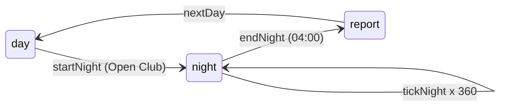
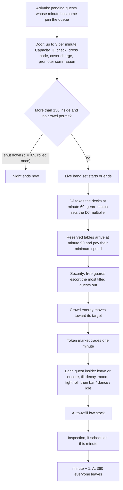

NYXERON's simulation lives in one pure TypeScript package. It has no clock, no network and no DOM. Every rule is a function that takes a game state and returns a new one. **Why:** the same code runs the browser game, the balance bot and the tests, and any night can be replayed exactly from its seed.

## State in, state out

The whole game is a single value $S$: coin, reputation, hype, safety, stock, staff, permits, prices, the current night (guests, crowd energy, market) and the random seed. Time inside a night is counted in minutes $t \in \lbrace 0, 1, \dots, 359 \rbrace$.

One minute of play is

$$
S_{t+1} = f(S_t, a_t, \xi_t)
$$

| Symbol | Meaning |
|---|---|
| $S_t$ | Full game state at the start of minute $t$ |
| $a_t$ | The player's actions issued during minute $t$ (promote, CEO call, crowd move, restock, force the door…), applied in order as pure functions $S \mapsto S'$ |
| $\xi_t$ | The random numbers drawn during the minute, $\xi_t = (u_1, u_2, \dots, u_K)$ with $u_i \in [0, 1)$ |
| $f$ | One tick (`tickNight`) applied to the state after the actions |

The noise $\xi_t$ is not external. It comes from a seeded deterministic pseudo-random generator whose seed is stored **inside** $S_t$ and advanced into $S_{t+1}$, so a night replays exactly. In practice

$$
S_{t+1} = \operatorname{tickNight}\big(a_t(S_t)\big)
$$

is a deterministic function of the state and the actions. The same seed and the same actions give the same night, bit for bit.

## Random decisions

Every random decision in the game is built from a uniform draw $u \in [0, 1)$:

| Helper | Definition | Distribution |
|---|---|---|
| `chance(p)` | $u \lt p$ | Bernoulli($p$) |
| `int(a, b)` | $a + \lfloor u\,(b - a + 1) \rfloor$ | uniform on $\lbrace a, \dots, b \rbrace$ |
| `pick(A)` | $A_{\lfloor u \lvert A \rvert \rfloor}$ | uniform over the list |
| `weighted(w)` | first key $k$ where $u \sum_j w_j - \sum_{i \le k} w_i \lt 0$ | $\Pr(k) = w_k / \sum_j w_j$ |

## Day, night, report

A game day has three phases. The player plans by day, watches the club run by night, and reads the result in the report.

The night opens at 22:00 and runs 360 one-minute ticks, so minute $t$ is clock time 22:00 + $t$ and the club closes at 04:00. A headless night is literally

$$
S_{\text{report}} = \operatorname{endNight}\Big(\operatorname{tickNight}^{\,360}\big(\operatorname{startNight}(S_{\text{day}})\big)\Big)
$$

| Parameter | Value |
|---|---|
| Ticks per night | 360 |
| Opening hour | 22 |
| Arrival window | 240 min |
| DJ set starts | minute 60 (23:00) |
| Reserved tables arrive | minute 90 (23:30) |

### startNight: building tonight

`startNight` runs once when the player opens the club. It draws everything that is decided in advance:

1. **Tonight's guests.** The expected head count, each guest's segment, genre, budget, arrival and leave minute (see [Guests & spending](/engine/guests)).
2. **Promoter guest lists**, which arrive early and skip the cover.
3. **Happy-hour reshuffles** of arrival or leave times, if a scheduled happy hour is set.
4. **The inspection roll.** With probability $p_{\text{insp}}$ an inspector is scheduled at a uniform minute in $\lbrace 0, \dots, 359 \rbrace$ (see [Crowd, DJ & security](/engine/crowd)).
5. **Fresh night state:** crowd energy starts at 30, market multipliers at 1, DJ multiplier at the no-DJ value 0.5, and tonight's table bookings are fixed.

If the venue is sealed (a penalty from a failed inspection), no guests are generated and no inspector comes.

### tickNight: one minute

Each tick runs the same steps in the same order. The order matters: a guest admitted at the door this minute already counts toward the crowd check, the escorts and the energy update of that same minute.

| Step | Explained in |
|---|---|
| Arrivals and door | [Guests & spending](/engine/guests) |
| Crowd-permit shutdown | [Crowd, DJ & security](/engine/crowd) |
| Band and DJ | [Crowd, DJ & security](/engine/crowd) |
| Tables | [Guests & spending](/engine/guests) |
| Escorts | [Crowd, DJ & security](/engine/crowd) |
| Energy | [Crowd, DJ & security](/engine/crowd) |
| Market | [Guests & spending](/engine/guests) |
| Guest loop | both pages |
| Auto-refill | stock management |
| Inspection | [Crowd, DJ & security](/engine/crowd) |

Guests drawn at `startNight` are sorted by arrival minute and processed in that order, so when the bar is busy the earliest arrivals are served first. Guests pulled in by a promo posted during the night are appended after them, so they are processed last whatever their arrival minute.

### endNight: the books close

At 04:00 (or at a shutdown) `endNight` settles the night in a fixed order:

1. **Entertainment tax** on the night's revenue: $\text{tax} = \operatorname{round}\big(r_L \cdot (\text{bar} + \text{cover} + \text{table})\big)$, with rate $r_L$ = 0, 0, 0.2, 0.3, 0.4 for levels 1–5.
2. **Shutdown penalty**, if the crowd-permit check closed the club.
3. **Reputation** from the average guest satisfaction.
4. **Night report**, then the defeat check and the victory check.

### nextDay: overnight

`nextDay` turns the report into a fresh day $d + 1$:

$$
\begin{aligned}
\text{coin}_{d+1} &= \text{coin}_d - \sum_{r} n_r\, w_r - \text{rent}_L \\
H_{d+1} &= \max(0,\; H_d - 10) \\
\text{Safety}_{d+1} &= \min(100,\; \text{Safety}_d + 10)
\end{aligned}
$$

where $n_r$ is the head count of staff role $r$, $w_r$ its daily wage (300, 400, 600, 700, 1500), $\text{rent}_L$ the venue's rent (100 to 30000), $H$ hype and Safety the safety stat. CEO energy resets to 5, stock orders that are due are delivered, and tonight's DJ, band, promos and promoters are cleared.

| Parameter | Value |
|---|---|
| Hype decay | 10 per day |
| Safety recovery | 10 per day |
| CEO energy | 5 per day |

<CardGroup cols={2}>
  <Card title="Guests & spending" icon="users" href="/engine/guests">
    Who comes, what they pay at the door, and when they buy.
  </Card>
  <Card title="Crowd, DJ & security" icon="music" href="/engine/crowd">
    Energy, the DJ multiplier, fights, inspections and the 0–100 stats.
  </Card>
</CardGroup>
