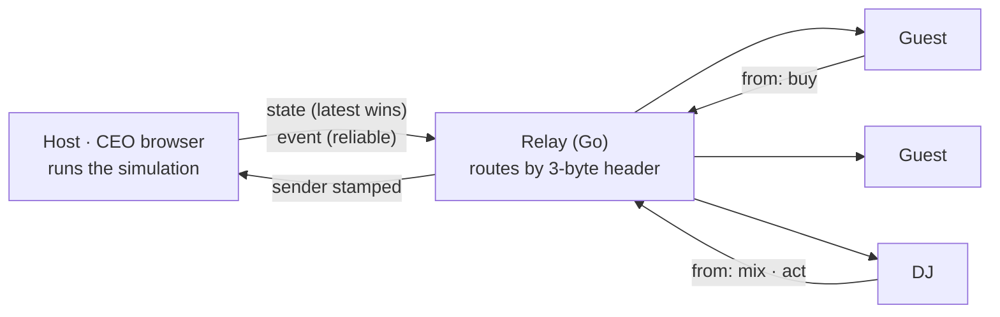
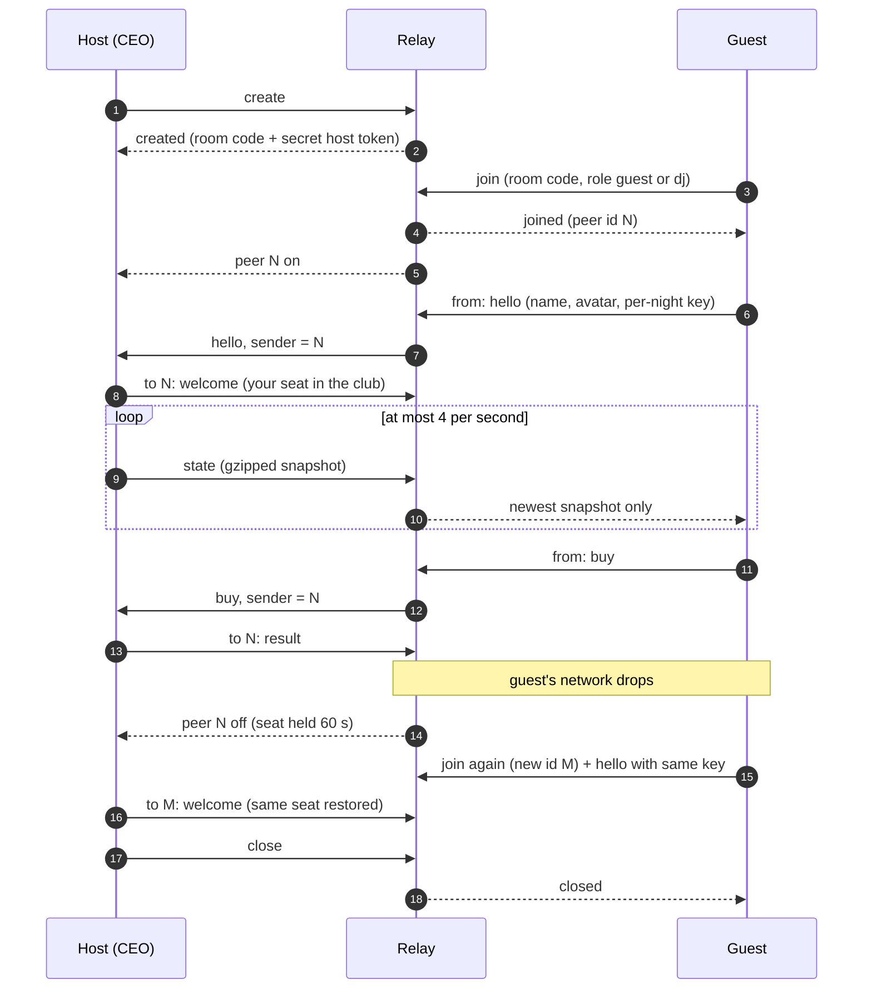

A live NYXERON night is one CEO's club, open to anyone with the room code. Guests walk in, buy tokens at the bar and
watch the crowd; a DJ can take the decks and play a set that everyone in the room hears. All of it runs through a
relay of about 700 lines of Go and never looks inside a message.

## Host-authoritative by design

One browser owns the truth. The CEO's browser already runs the full simulation for a solo night, so in a live room it
simply keeps doing that and becomes the **host**:

- **Host (CEO)** runs `GameState`, applies every action, and broadcasts the result.
- **Guests and the DJ** send *intents* only: "I want to buy 2 TSLA", "here is my mix". They never edit state.
- **Relay** routes frames between them. It has no game logic, no database, and does not parse payloads.

Why: there is exactly one simulation per club, so there is nothing to reconcile and no way for two browsers to
disagree about the night. The relay stays cheap enough to host thousands of rooms in a 48 MB container.

## The wire: a 3-byte header

Every game message is a binary WebSocket frame with a fixed 3-byte header followed by an opaque payload.

| Byte | Field | Meaning |
| --- | --- | --- |
| 0 | `kind` (u8) | What the relay should do with the frame (table below) |
| 1–2 | `peer` (u16, big-endian) | For `to`: the target peer. For `from`: the sender, **overwritten by the relay**, so it cannot be spoofed |
| 3… | payload | Opaque to the relay. JSON, or gzipped JSON for snapshots |

Source: `services/relay/protocol.go:27-31`, `apps/web/src/net/relay.ts:28-35`

| Kind | Value | Direction | Delivery |
| --- | --- | --- | --- |
| `state` | 1 | host → all peers | **Latest wins.** Each peer has a single snapshot slot; a slow peer skips stale snapshots instead of queueing them |
| `event` | 2 | host → all peers | Reliable and ordered (DJ mix, pads, shout-outs, who is on the decks) |
| `to` | 3 | host → one peer | Reliable (welcome, purchase result) |
| `from` | 4 | peer → host | Guest or DJ input; the relay stamps the sender id |

Entering and leaving a room uses a handful of small JSON text messages: `create`, `join`, `resume`, `kick`, `close`
from clients, and `created`, `joined`, `peer`, `host`, `kicked`, `closed`, `error` from the relay.

A snapshot is the public club state serialized to JSON and gzipped with the browser's built-in `CompressionStream`
(no library). A busy night is about 100 KB of JSON and 10–15 KB on the wire. The host sends one at most every
250 ms, coalescing every action in between.

Source: `apps/web/src/net/codec.ts:4`, `apps/web/src/net/session.ts:182`

## Room lifecycle

- **Room codes** are 6 characters from a 31-symbol alphabet that leaves out look-alikes (0, O, 1, I, L), drawn with
  a cryptographic RNG: $31^6 \approx 8.9 \times 10^8$ possible codes.
- **The host token** (16 random bytes) is what makes a browser the host; it is kept in the tab's session storage.
- **Guests are admitted at night.** A `hello` during the day waits until the club opens.
- **One DJ at a time.** A second DJ is turned away until the decks are free.

## DJ sync: state, not audio

Streaming a DJ set to every guest would cost each listener an audio stream. NYXERON sends the *mix* instead: every
browser already has the same track crate, so the DJ only needs to say what the decks are doing.

Four times a second the DJ's browser sends a `MixSync`: for each deck the track id, play state, playhead, tempo,
reverse flag, loop, and the channel's EQ, filter and fader settings, plus the crossfader. One-shot moves (pads,
brake, backspin) travel as separate events the moment they happen. The host relays both to the whole room as reliable
events, and every browser plays the set on its own Web Audio engine.

### Bandwidth

$$
B_{\text{listener}} = f \cdot (h + s)
$$

where

| Symbol | Meaning | Value |
| --- | --- | --- |
| $f$ | Mix update rate | 4 Hz (every 250 ms) |
| $h$ | Frame header | 3 B |
| $s$ | `MixSync` payload | about 300 B (design target) |

Source: `apps/web/src/net/session.ts:611-613`, `apps/web/src/dj/mixsync.ts:5`

So $B_{\text{listener}} \approx 4 \times 303 \approx 1.2\ \text{kB/s} \approx 9.7\ \text{kbit/s}$. A modest
128 kbit/s audio stream would be about 13 times more, per listener, and would add encoding delay on top. For a room
with $N$ listeners the relay sends roughly $N \cdot B_{\text{listener}}$, so even a full room of 64 stays under
80 kB/s of mix traffic.

### Staying on the beat

The mix arrives a little late, so each follower aims slightly ahead of where the DJ was when the message was sent,
and only jumps when it is clearly off: a small drift is inaudible, a seek is not.

$$
\tau =
\begin{cases}
p + d \cdot L \cdot r & \text{if the deck is playing} \\
p & \text{if it is paused}
\end{cases}
\qquad
d =
\begin{cases}
-1 & \text{reverse} \\
+1 & \text{forward}
\end{cases}
$$

$$
\text{seek to } \tau \iff \lvert x - \tau \rvert > \Delta
$$

where

| Symbol | Meaning | Value |
| --- | --- | --- |
| $\tau$ | Target playhead on the follower (s) | computed |
| $p$ | DJ's playhead when the message was sent, rounded to 1 ms (s) | from `MixSync` |
| $r$ | Deck tempo (playback rate, 1 = original speed) | from `MixSync` |
| $L$ | Assumed one-way delay from the DJ to a listener (s) | 0.12 s, `LATENCY` |
| $x$ | Follower's current playhead (s) | local |
| $\Delta$ | Drift tolerance before a seek (s) | 0.25 s, `DRIFT` |

Source: `apps/web/src/dj/mixsync.ts:27-64`

Play, pause, track loads, tempo, loops and EQ are applied immediately; only the playhead uses the tolerance. A track
that is still loading is never loaded twice, and a track a listener does not have simply stays silent on that deck.

<Accordion title="Worked example">
The DJ's deck A is playing forward at tempo $r = 1.04$ and reports $p = 62.500$ s.

$$
\tau = 62.500 + 1 \cdot 0.12 \cdot 1.04 = 62.6248\ \text{s}
$$

A listener whose deck is at $x = 62.48$ s is off by $\lvert 62.48 - 62.6248 \rvert = 0.1448$ s, below
$\Delta = 0.25$ s: it keeps playing untouched. A listener at $x = 62.30$ s is off by $0.3248$ s and seeks to
62.6248 s.
</Accordion>

## Reconnects

Phones lose signal and laptops sleep; a live club has to survive that.

**Backoff.** After a drop, a client waits with exponential backoff and *equal jitter*, so a relay restart is not
hit by every player at the same instant:

$$
b_k = \min\left(8000,\ 500 \cdot 2^{k}\right)\ \text{ms}, \qquad
w_k = \frac{b_k}{2} + U_k\,\frac{b_k}{2}, \quad U_k \sim \mathcal{U}[0,1), \qquad k = 0, 1, 2, \dots
$$

so the first wait falls in $[0.25, 0.5)$ s and the waits settle in $[4, 8)$ s. The counter $k$ resets only after a
connection has held for more than 10 s, so a server that accepts and immediately drops can't make clients spin. A
client stops for good when it is kicked, its room is closed or gone, or another tab takes the room over
(`replaced`).

Source: `apps/web/src/net/relay.ts:227-241`

**Guests and DJs** get a new peer id on every reconnect, so the seat is tied to something else: a secret key chosen
for that night. The host holds a disconnected guest's seat for 60 seconds; when the guest's `hello` comes back with
the same key, the host binds the old seat, with everything in it, to the new id.

**The host** reconnects with `resume` and its secret token. Peers are told `host off` and then `host on`; the relay
re-announces every peer still in the room and they send `hello` again. If the host stays away longer than the
60-second grace period the room closes, but the same code can be resumed for up to an hour, so invite links and
scheduled events keep working.

Source: `apps/web/src/net/session.ts:177`, `services/relay/hub.go:68`, `services/relay/main.go:206`

## Built-in limits

The relay protects itself and every room with fixed budgets.

| Limit | Host | Guest / DJ | Before joining |
| --- | --- | --- | --- |
| Max frame size | 256 KiB | 8 KiB | 1 KiB |
| Messages per second (burst) | 60 (120) | 20 (40) | 5 (10) |

| Relay setting | Default | Why |
| --- | --- | --- |
| Rooms per relay | 2000 (`MAX_ROOMS`) | when full, the room abandoned longest closes early (still resumable) instead of refusing a real CEO |
| Peers per room | 64 (`MAX_PEERS`) | |
| Host grace period | 60 s (`GRACE_SEC`) | |
| Sockets in total / per IP | 1000 / 100 | memory stays bounded |
| Hello deadline | 10 s | a socket that never creates, joins or resumes is closed |
| Rooms with a live host per IP | 8 | one client can't take every room |
| Wrong room codes per IP | 20, then 12 a minute | codes can't be guessed |
| Queued bytes per client / all clients | 256 KiB / 16 MiB | a client that stops reading is dropped, never pins memory; guest input may fill only half the host's queue, so a host is never dropped for its guests' spam |
| Kick | that IP can't rejoin the room for 10 min | |
| Ping interval / write timeout | 25 s / 5 s | |

Source: `services/relay/conn.go:16-39`, `services/relay/hub.go:59-75`, `services/relay/main.go:206-211`

Each connection has exactly one reader and one writer goroutine; the writer is the only code that touches the socket.
The relay is covered by Go tests run with the race detector: routing and sender stamping, join errors, host resume and
grace, kick and close, and rate limits, plus adversarial tests that attack it on purpose: clients that stop
reading, connection and room floods, guessed room codes, a guest flooding the host. A bundled load-test tool drives
many rooms of simulated peers against it: 10 clubs × 30 players get 100% of snapshots delivered in about 31 MB.

Source: `services/relay/brutal_test.go`, `services/relay/cmd/loadtest/main.go`, `docs/changelog.md`
